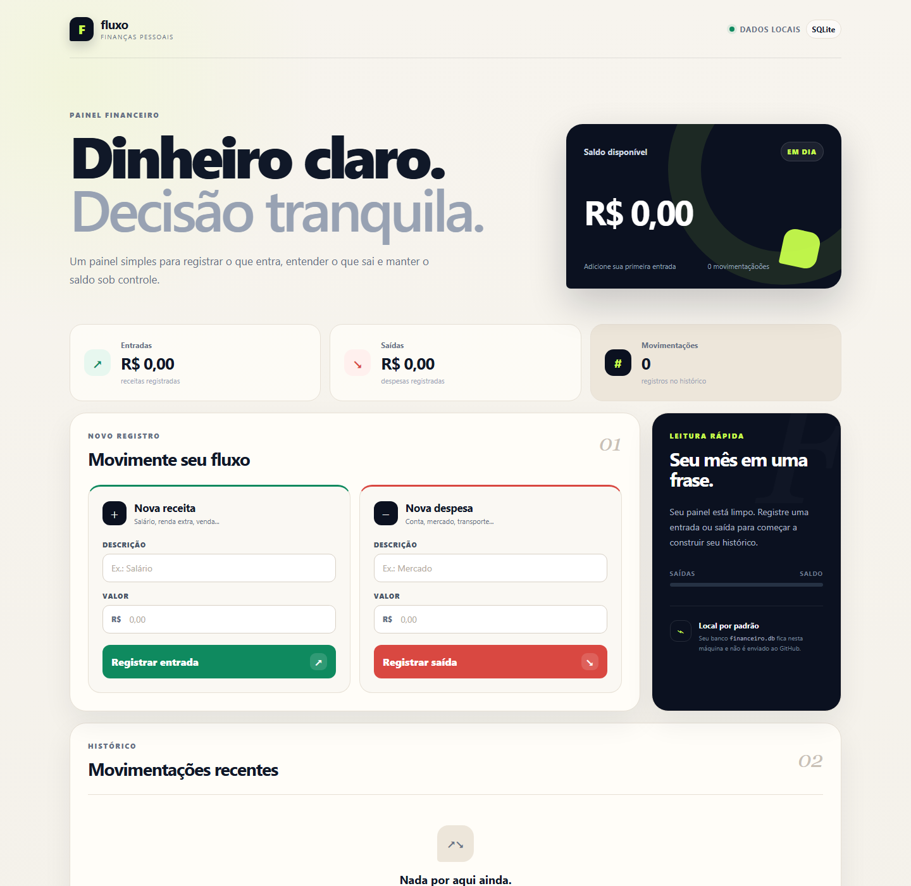

# Fluxo — Controle Financeiro

Um painel financeiro pessoal desenvolvido em **Python + Flask + SQLite**, criado a partir da evolução de um projeto de terminal.

O objetivo foi transformar exercícios de lógica e Python em uma aplicação pequena, funcional e apresentável para portfólio.



## ✦ O que o sistema faz

- registra receitas e despesas;
- calcula saldo, total de entradas e total de saídas;
- mantém um histórico único de movimentações;
- salva os dados localmente com SQLite;
- aceita valores no formato brasileiro, como `1.250,90`;
- formata os valores em reais;
- permite excluir movimentações;
- valida campos e valores inválidos;
- possui layout responsivo para desktop e celular;
- mantém o banco local fora do GitHub.

## ✦ Stack

```text
Python
├── Flask
└── SQLite

Frontend
├── HTML
├── CSS
└── Jinja

Versionamento
├── Git
└── GitHub
```

## ✦ Arquitetura

```text
Navegador
    ↓
HTML + CSS
    ↓
Flask
    ↓
Python
    ↓
SQLite
    ↓
financeiro.db
```

O arquivo `financeiro.db` é criado automaticamente e fica somente na máquina local.

## ✦ Estrutura do projeto

```text
controle-financeiro-python/
│
├── app.py
├── controle_financeiro.py
├── requirements.txt
├── README.md
├── .gitignore
│
├── templates/
│   └── index.html
│
├── static/
│   ├── style.css
│   └── favicon.svg
│
└── docs/
    └── preview.png
```

### `controle_financeiro.py`

Primeira versão do projeto, executada no terminal.

Foi usada para praticar lógica antes da construção da interface web.

### `app.py`

Backend da versão web. Nele ficam:

- rotas Flask;
- validações;
- comunicação com SQLite;
- cálculos do resumo financeiro;
- formatação de valores e datas.

## ✦ Como executar

### 1. Clone o repositório

```bash
git clone https://github.com/felipe110606/controle-financeiro-python.git
cd controle-financeiro-python
```

### 2. Crie o ambiente virtual

```bash
python -m venv .venv
```

### 3. Ative no Windows

```powershell
.\.venv\Scripts\Activate.ps1
```

### 4. Instale as dependências

```bash
pip install -r requirements.txt
```

### 5. Execute

```bash
python app.py
```

### 6. Abra no navegador

```text
http://127.0.0.1:5000
```

## ✦ Conceitos praticados

Durante a evolução do projeto foram usados:

- variáveis e tipos de dados;
- condicionais;
- laços;
- listas e dicionários;
- funções, parâmetros e retornos;
- tratamento de erros;
- rotas GET e POST;
- formulários HTML;
- templates Jinja;
- SQL básico;
- `CREATE TABLE`;
- `SELECT`;
- `INSERT`;
- `DELETE`;
- persistência de dados;
- Git, commits, branches e push.

## ✦ Evolução

O projeto começou como uma aplicação simples de terminal e foi evoluído em etapas:

```text
Terminal
   ↓
Funções e validações
   ↓
Flask
   ↓
HTML + CSS
   ↓
Formulários web
   ↓
SQLite
   ↓
Dashboard responsivo
```

## ✦ Próximos passos possíveis

- edição de movimentações;
- categorias;
- filtros por período;
- gráficos;
- testes automatizados;
- autenticação;
- deploy da aplicação.

---

Projeto desenvolvido durante meus estudos de **Python e desenvolvimento de software**.
